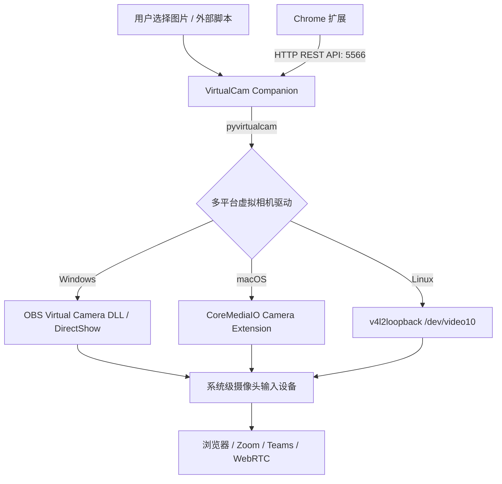
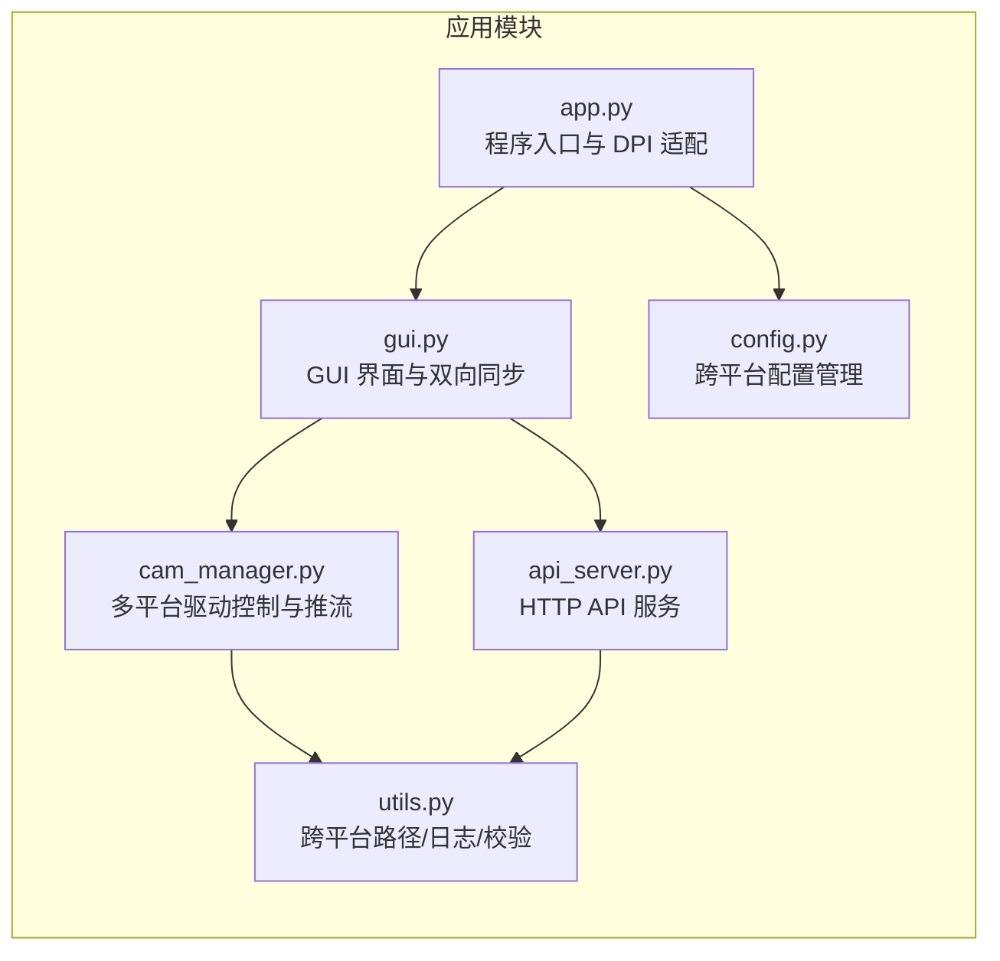

<div align="center">

# VirtualCam Companion

**系统级虚拟摄像头工具 -- 让任何网页/软件都能检测到虚拟摄像头**

[](https://github.com/GreenhandTan/virtual-cam-companion/stargazers)
[](https://opensource.org/licenses/MIT)
[](https://github.com/GreenhandTan/virtual-cam-companion/releases/latest)
[](https://github.com/GreenhandTan/virtual-cam-companion/releases)


</div>

---

## 功能特性

- **跨平台系统级虚拟摄像头** -- 支持 **Windows** (DirectShow), **macOS** (CoreMediaIO Extension), **Linux** (v4l2loopback)，任何网页/会议软件都能识别
- **图片与流输出** -- 支持 JPG / PNG / BMP / WebP 格式图片作为摄像头画面，并保持 30fps 持续推流
- **HTTP API 联动** -- 内置 REST API（端口 5566），与 GUI 状态双向实时同步，可被 Chrome 扩展或自动化脚本远程调用
- **开箱即用与跨平台配置** -- Windows 包含一体化静默驱动安装；macOS/Linux 提供一键引导脚本；配置及日志遵循各操作系统规范
- **现代化可视化界面** -- 基于 tkinter 的深色现代化 GUI，支持实时缩略图预览、状态指示、自适应高分屏缩放

## 快速开始

### 下载安装

前往 [Releases](https://github.com/GreenhandTan/virtual-cam-companion/releases/latest) 下载对应平台的安装包：

#### 🪟 Windows
1. 下载 `VirtualCamCompanion-Setup.exe` 并安装（安装包已内置驱动并自动注册）。
2. 安装完成后直接启动即可。

#### 🍏 macOS
1. 下载 `VirtualCamCompanion-macOS.dmg`，将应用拖拽到 `Applications` 目录。
2. **一次性前置配置**：由于 macOS 13+ 的系统扩展权限要求，请确保已安装 [OBS Studio 30+](https://obsproject.com)（或 `brew install --cask obs`）。打开 OBS 点击一次『启动虚拟摄像机』后关闭即可激活驱动。

#### 🐧 Linux
1. 下载 `VirtualCamCompanion-Linux-x86_64.tar.gz` 并解压。
2. **内核模块准备**：执行解压目录中的一键脚本加载 `v4l2loopback` 驱动：
   ```bash
   sudo bash scripts/setup_linux_v4l2.sh
   ```
3. 运行 `./VirtualCamCompanion` 即可。

---

### 使用方法

1. 点击 **选择图片** 加载要显示的画面（或通过 Chrome 扩展推送）
2. 点击 **启动摄像头**
3. 打开浏览器 / Zoom / Teams / 腾讯会议，选择 **OBS Virtual Camera**（或对应的虚拟摄像头设备）
4. 网页/软件看到的就是你选择的实时画面

### 配合 Chrome 扩展使用

1. 启动本程序（HTTP API 自动在本地监听 `127.0.0.1:5566`）
2. 安装 [VirtualCam Extension](https://github.com/GreenhandTan/virtual-cam-extension)
3. 在扩展中选择图片，自动发送到本程序，虚拟摄像头输出该画面，桌面 GUI 同步刷新预览

---

## 工作原理





## HTTP API

程序启动后自动开启本地 HTTP 服务，供 Chrome 扩展或自动化调用：

| 接口 | 方法 | 说明 |
|------|------|------|
| `/api/ping` | GET | 心跳检测，确认程序是否在后台运行 |
| `/api/status` | GET | 获取运行状态（平台、是否启动、设备名、是否有图片） |
| `/api/set_image` | POST | 发送图片（body: `{"image": "base64..."}`），GUI 自动同步刷新预览 |
| `/api/start` | POST | 启动虚拟摄像头推流，GUI 按钮联动更新 |
| `/api/stop` | POST | 停止虚拟摄像头推流，GUI 按钮联动更新 |

---

## 技术栈与平台适配

| 类别 | 技术 | 跨平台说明 |
|------|------|------|
| **编程语言** | Python 3.8+ | Windows / macOS / Linux 统一核心代码 |
| **GUI** | tkinter + Pillow | 自适应高分屏 (DPI)，跨平台字体与图标自适应 |
| **底层驱动** | pyvirtualcam | Windows (DirectShow) / macOS (CoreMediaIO) / Linux (V4L2) |
| **图像处理** | OpenCV, Pillow | 自动适应 16:9 (1280x720) 与色彩空间转换 |
| **网络通信** | HTTP Server | 内置单机 REST API，支持 CORS 跨域 |
| **打包分发** | PyInstaller, Inno Setup | Windows: Setup.exe / macOS: .dmg / Linux: tar.gz |
| **CI/CD** | GitHub Actions | 矩阵全自动多平台构建与发布 Release |

---

## 项目结构

```
virtual-cam-companion/
├── app.py                    # 程序入口 (Windows DPI 适配与初始化)
├── config.py                 # 跨平台配置管理模块 (AppData/Application Support/XDG)
├── cam_manager.py            # 跨平台虚拟摄像头核心模块 (Windows/macOS/Linux)
├── api_server.py             # HTTP API 服务模块 (CORS 支持、双向同步)
├── gui.py                    # 跨平台 GUI 界面模块 (高分屏、实时同步预览)
├── utils.py                  # 工具函数 (跨平台日志轮转、图片魔数校验、路径解析)
├── requirements.txt          # Python 依赖清单
├── setup.iss                 # Windows Inno Setup 安装包脚本
├── app.ico / app.png / app.icns # 各平台图标资产
├── LICENSE                   # MIT 开源协议
├── README.md                 # 本说明文档
├── scripts/
│   ├── setup_linux_v4l2.sh   # Linux v4l2loopback 驱动一键配置脚本
│   ├── setup_macos.sh        # macOS OBS 虚拟相机扩展检测脚本
│   ├── extract_obs_vcam.ps1  # Windows CI 提取 OBS 驱动脚本
│   └── extract_driver.py     # 从 pyvirtualcam 提取驱动（备用）
└── .github/workflows/
    └── build.yml             # GitHub Actions 跨平台矩阵自动构建流水线
```

---

## 开发与本地运行

```bash
# 1. 克隆项目
git clone https://github.com/GreenhandTan/virtual-cam-companion.git
cd virtual-cam-companion

# 2. 安装依赖
pip install pyvirtualcam opencv-python Pillow

# 3. 运行应用
python app.py
```

---

## 常见问题

**Q: 浏览器或会议软件中看不到虚拟摄像头？**
- **Windows**: 确保在程序中点击了『启动摄像头』，并刷新网页。如果未检测到设备，重启一次程序或重新运行安装包。
- **macOS**: macOS 13+ 需要在 OBS Studio 中启动一次虚拟摄像机以激活系统级 `CoreMediaIO` 扩展，如提示系统扩展被阻止，请至「系统设置 -> 隐私与安全性」中授权允许。
- **Linux**: 确保已执行 `sudo bash scripts/setup_linux_v4l2.sh` 加载了 `v4l2loopback` 模块生成 `/dev/video10`。

**Q: 画面拉伸变形？**
虚拟摄像头输出标准格式为 1280x720 (16:9)，如果图片比例不一致会自动等比缩放适配。

**Q: 支持哪些操作系统？**
- Windows 10 / 11 (64位)
- macOS 13+ (Ventura, Sonoma, Sequoia / Intel & Apple Silicon)
- Linux (Ubuntu 20.04+, Debian 11+, Fedora, Arch Linux 等主流发行版)

---

## 开源协议

本项目基于 [MIT License](LICENSE) 开源。
